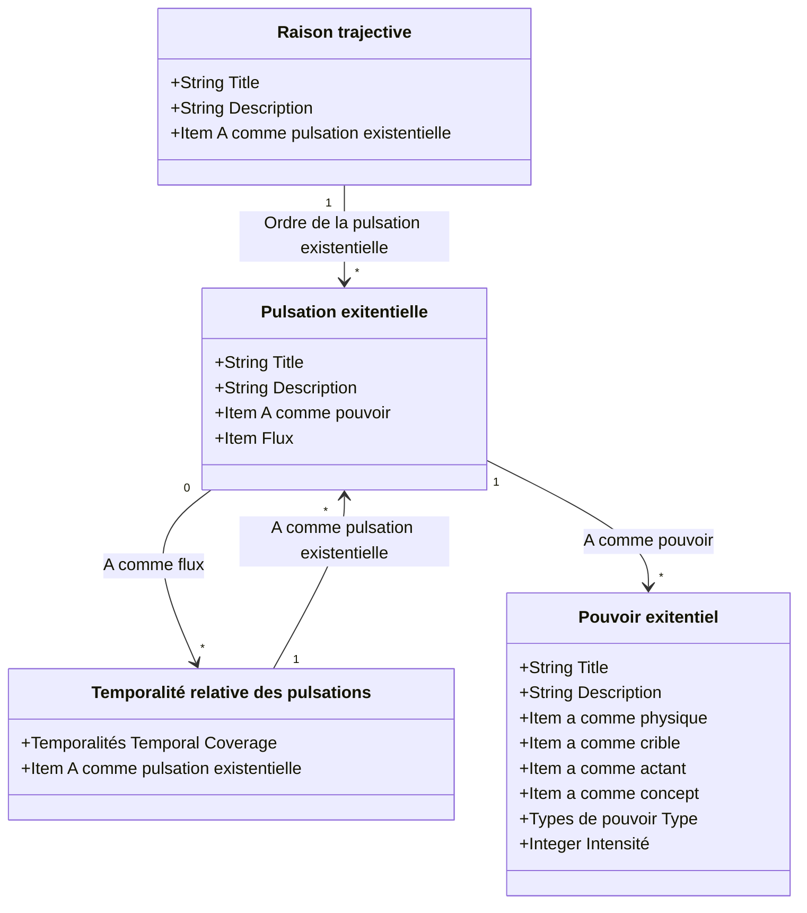

# ACEHN_26-27_analyse
Projets pour le cours de Méthode et outils d'analyse 

## Exercises CSV
1. créer une page Web dans votre github = Ex2a.html
2. créer un Google Form pour répondre à l'enquête Articial Inquiries : Ex2a - All the Things You Do
3. mettre à disposition le google Form dans la page web à partir de la fonction Google Form : Intégrer dans le code HTML
cf. Ex2a.html de ce github.
4. Activer les Github Pages dans votre repository : Settings / pages / branche main / root
5. enregistrer 3 réponses à ce formulaire
6. enregistrer le csv de ces trois réponses dans votre github : /data/Ex2a.csv
Dans le tableur Drive : Fichier / télécharger / valeurs séparées par des virgules
7. remplir le formulaire suivant :
   - https://docs.google.com/forms/d/e/1FAIpQLSc6MZEa1HzxB0yg5oqSnT4w_YOjylJbQqVxO87Yzu4c7TPh_Q/viewform?usp=header 
   - https://humanites-numeriques-universite-paris-8.github.io/ACEHN_26-27_analyse/Ex2a.html

## Exercises modélisation d'un objet
1. créer un diagramme mermaid pour décrire les réponses du formulaire Ex2a - All the Things You Do
par exemple :

